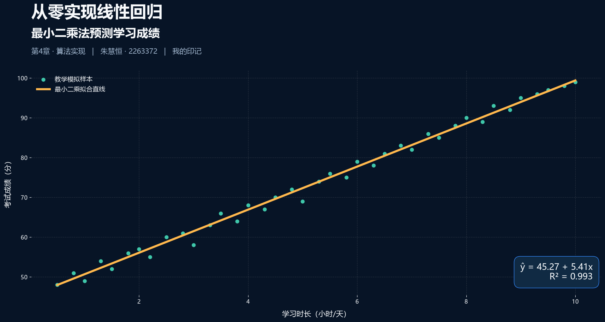
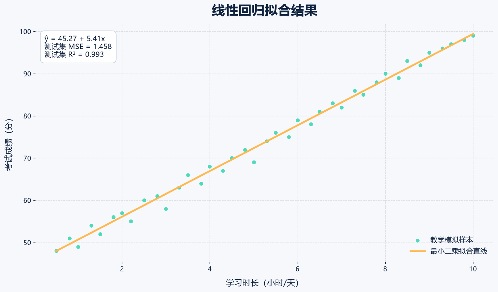
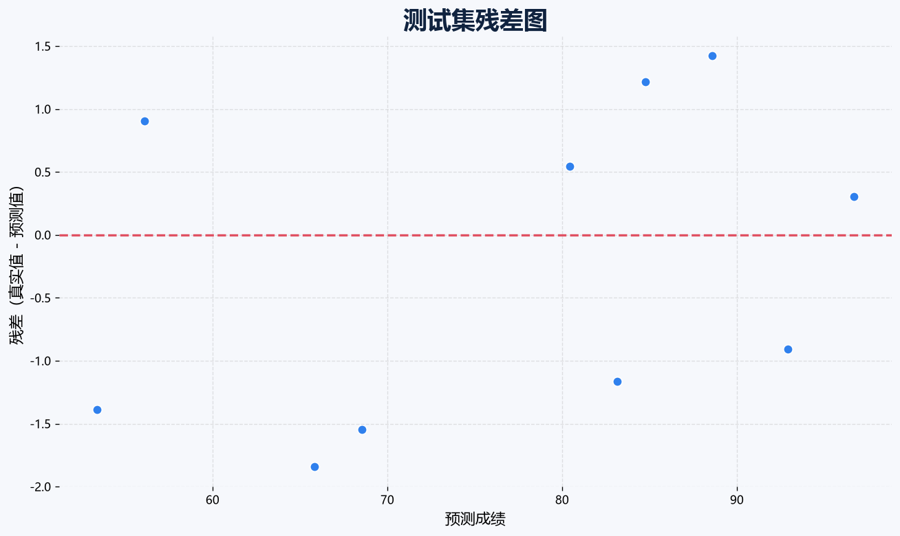

# 从零实现线性回归：最小二乘法预测学习成绩

> 第4章《线性回归》算法实现作业  
> DHU 2263372

本项目使用“每天学习时长 → 考试成绩”的教学模拟数据，完整展示线性回归从数学公式到代码实现的过程。核心模型没有直接调用现成回归算法，而是使用 NumPy 和 Moore-Penrose 伪逆手写最小二乘闭式解；随后再与 `sklearn.linear_model.LinearRegression` 的结果对照，并用 MSE、RMSE、MAE 和 R² 评价模型。



## 1. 问题定义

已知每名学生每天的学习时长 `x` 与考试成绩 `y`，希望学习一个线性函数：

$$
\hat{y}=w_0+w_1x
$$

其中，$w_0$ 是截距，$w_1$ 是学习时长对应的回归系数，$\hat{y}$ 是模型预测的考试成绩。

数据位于 `data/study_hours_scores.csv`。这是为了课堂演示构造的模拟数据，不代表真实学生或真实考试结果。`student_id` 仅用于标识样本，不参与模型训练，避免把无实际意义的编号误当作特征。

## 2. 最小二乘法

模型通过最小化所有样本的平方误差和来寻找最佳参数：

$$
J(w)=\sum_{i=1}^{n}\left(y_i-\hat{y}_i\right)^2
$$

加入一列常数 1 后，设计矩阵记作 $X$，参数向量记作 $\theta$，普通最小二乘的正规方程为：

$$
\theta=(X^TX)^{-1}X^Ty
$$

实际代码使用数值更稳健的 Moore-Penrose 伪逆：

```python
design = np.column_stack([np.ones(x.shape[0]), x])
theta = np.linalg.pinv(design) @ y
```

伪逆在矩阵不可逆或特征高度相关时仍能给出最小二乘解，比直接计算矩阵逆更安全。

## 3. 项目结构

```text
linear-regression-from-scratch/
├─ data/
│  └─ study_hours_scores.csv    # 教学模拟数据
├─ outputs/
│  ├─ fit_plot.png              # 拟合直线图
│  ├─ residual_plot.png         # 测试集残差图
│  ├─ submission_cover.png      # 16:9 作业封面
│  ├─ predictions.csv           # 测试集预测明细
│  └─ metrics.json              # 模型参数与评估指标
├─ tests/
│  └─ test_linear_regression.py # 3 个自动化测试
├─ linear_regression.py         # 手写实现、sklearn 对照、可视化
├─ requirements.txt
└─ README.md
```

## 4. 运行方法

建议使用 Python 3.10 或更高版本。

### Windows PowerShell

```powershell
python -m venv .venv
.venv\Scripts\Activate.ps1
pip install -r requirements.txt
python linear_regression.py
pytest -q
```

### macOS / Linux

```bash
python3 -m venv .venv
source .venv/bin/activate
pip install -r requirements.txt
python linear_regression.py
pytest -q
```

脚本默认按 75%/25% 划分训练集和测试集，并固定随机种子为 42，保证结果可复现。也可以自定义参数：

```bash
python linear_regression.py --data data/study_hours_scores.csv --test-size 0.25 --seed 42
```

## 5. 实现流程

1. 读取并检查 CSV 数据；
2. 只选取 `study_hours` 作为输入特征；
3. 划分训练集和测试集；
4. 用伪逆求最小二乘闭式解；
5. 在测试集上生成预测；
6. 手写计算 MSE、RMSE、MAE 和 R²；
7. 训练 sklearn 模型并核对参数与预测结果；
8. 输出 JSON、CSV 和可视化图片；
9. 运行自动化测试，验证模型正确性。

## 6. 评估指标

- **MSE（均方误差）**：误差平方的平均值，对较大误差更敏感，越小越好。
- **RMSE（均方根误差）**：MSE 开平方，与成绩使用相同单位，更直观，越小越好。
- **MAE（平均绝对误差）**：平均偏差大小，不会像 MSE 一样强烈放大异常值，越小越好。
- **R²（决定系数）**：模型解释目标变量波动的比例，越接近 1 越好。

本项目使用固定随机种子 42 的实际运行结果如下：

| 模型 | 截距 | 斜率 | MSE | RMSE | MAE | R² |
|---|---:|---:|---:|---:|---:|---:|
| 手写最小二乘 | 45.2671 | 5.4136 | 1.4578 | 1.2074 | 1.1233 | 0.9934 |
| sklearn | 45.2671 | 5.4136 | 1.4578 | 1.2074 | 1.1233 | 0.9934 |

手写模型与 sklearn 模型预测值的最大绝对差约为 `2.84e-14`，仅来自浮点计算误差。完整精度数据保存在 `outputs/metrics.json`。

## 7. 结果可视化

### 拟合效果



散点表示原始样本，橙色直线表示手写最小二乘模型。斜率为正，说明在这组模拟数据中，学习时长增加时考试成绩整体呈上升趋势。

### 残差分析



如果残差大致随机分布在 0 附近，说明线性关系基本合理；若出现明显曲线或漏斗形状，则可能需要非线性特征、数据变换或其他模型。

## 8. sklearn 对照

项目同时训练 sklearn 模型：

```python
sklearn_model = LinearRegression().fit(x_train, y_train)
sklearn_predictions = sklearn_model.predict(x_test)
```

脚本会计算手写模型与 sklearn 预测结果的最大绝对差。自动化测试要求两者在 `1e-10` 的容差范围内一致，这说明手写的最小二乘实现是正确的。

## 9. 常见误区与改进方向

- **把相关性当作因果性**：本例只能说明变量间存在统计关系，不能证明多学习一小时必然导致相同幅度的提分。
- **训练集表现好就认为模型好**：必须保留测试集，检验模型对未见样本的泛化能力。
- **把编号当特征**：样本编号没有可解释的预测意义，使用它可能制造虚假关系。
- **忽视异常值**：最小二乘法会放大大误差，极端样本可能明显改变拟合直线。
- **超出数据范围外推**：模型主要在已有学习时长范围内可信，不能盲目预测极端情况。
- **单特征过于简单**：真实成绩还可能与基础水平、睡眠、复习方法等因素有关，可扩展为多元线性回归。

## 10. 总结

本项目完成了“数据读取 → 训练/测试集划分 → 手写最小二乘训练 → 预测 → 指标评估 → sklearn 对照 → 可视化 → 自动化测试”的完整闭环。它既展示了线性回归的数学原理，也提供了可直接运行、可复现和可扩展的 Python 实践代码。

---

**朱慧恒 · 2263372 · 我的印记**
